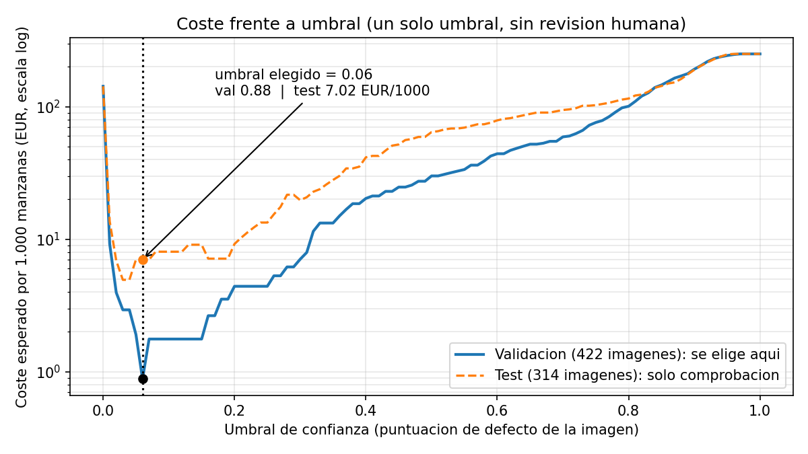

# Assignment 2 Report

- **Name**: Javier Comin
- **Student ID**: 20106
- **Email**: jcomin.ieu2022@student.ie.edu
- **Group**: BBADBA 5A

## Business problem, and the cost of being wrong

**Decision.** A fruit packhouse sorts apples on a conveyor belt. A camera photographs each apple and the model supports one decision per apple: **pass** it to packing, **reject** it (waste or industrial use), or send it to a **person for manual inspection**. The line's ejector acts on pass/reject automatically; a quality-control operator takes the review cases. I treat the *defective* apple as the **positive** class.

**What each mistake costs** (all figures per apple, in euros):

| Event | Cost | Where the figure comes from |
|---|---|---|
| False positive: a good apple is rejected | **0.15** | Source: Golden apple at 72.62 EUR/100 kg in week 20 of 2026 ([informe semanal de coyuntura](https://teseo.clal.it/upload/informe-semanal-de-coyuntura-2026-s-20.pdf)), i.e. 0.73 EUR/kg. **Assumption:** 200 g per apple, so 0.145, rounded to 0.15. The loss is the apple's market value. |
| False negative: a defective apple is shipped | **5.00** | **Assumption, no source:** refund of a 1 kg bag (about 2 EUR) plus handling the complaint (about 3 EUR). |
| One manual review | **0.036** | Source: INE, Encuesta Trimestral de Coste Laboral, Q2 2026, 26.18 EUR per effective hour ([INE](https://www.ine.es/dyngs/Prensa/ETCL2T26.pdf)). **Assumption:** 5 s per apple, so 26.18 / 3600 x 5 = 0.036. It is the national average for all sectors; a packhouse would probably pay less. |
| A person misjudges an apple | 2 % of reviews | **Assumption, no source.** |
| True positive / true negative | 0 | Nothing is lost when the model is right. |

**The asymmetry.** A missed defect costs about 33 times a wrongly rejected apple (5.00 / 0.15). I also assume **5 % of the apples reaching the line are defective** (no source). Per 1,000 apples, doing nothing costs 50 x 5 = **250 EUR**, and rejecting everything costs 950 x 0.15 = **142.50 EUR**. Both extremes are expensive; the model is useful only if it rejects selectively.

**How this framing drives the rest of the work:**

1. **One decision per apple, with the three defect classes merged into one positive class.** The action (reject) is the same whatever the kind of defect, so confusing `defect` with `rottenapple` costs nothing. The image-level score is the highest model confidence in any defect class.
2. **A 33:1 asymmetry** pushes the threshold low: it is cheap to reject a doubtful apple and expensive to ship a bad one.
3. **The dataset is mostly defective (77 % of test images) but production is not (5 %).** Every rate measured on the dataset is reweighted with the production base rate before it becomes a cost.
4. **A person costs 0.036 per apple**, so review is only worth it where the model is uncertain. That is tested, not assumed (see the last two sections).

## Dataset

- **Roboflow Universe:** workspace `kajal-tdslw`, project `final-apple-data`, **version 8**: <https://universe.roboflow.com/kajal-tdslw/final-apple-data>
- Used as published (not forked), downloaded with the Roboflow API in YOLO format.
- **One image** is a photo of one or more apples (378 labelled apples in 314 labelled test images, about 1.2 per image), with a box for each apple.
- **Classes (4):** `freshapples`, `rottenapple`, `damaged_apple`, `defect`.
- **Candidates considered:** `apple-nin9v`, `applesdet`, `fruit_9`; `fruit_defect_analyser` was discarded for having only 47 images. I chose this one for its size (7,910 images) and because it separates three kinds of defective apple from good ones.

**Does it serve the problem or only resemble it?** It serves the *decision*: labels distinguish good from defective apples at the apple level and the apples are large in the frame. It only *resembles* a conveyor belt: there is no belt, and the images come from a mix of sources (white-background cut-outs, screenshots, and pre-augmented variants; see the next section). I use it knowing this, and I treat my results as optimistic.

## What the dataset's composition implies

I computed the figures below from the labels (`dataset_stats.py`, `dataset_checks.py`).

| Split | Images | Of which without apples | `damaged_apple` | `defect` | `freshapples` | `rottenapple` |
|---|---|---|---|---|---|---|
| train | 6,921 | 375 | 1,458 | 2,100 | 1,350 | 3,041 |
| val | 659 | 27 | 188 | 145 | 140 | 283 |
| test | 330 | 16 | 34 | 113 | 73 | 158 |

The median apple covers 57 % (train), 49 % (val) and 53 % (test) of the image; at most 1 % of objects are under 1 % of the image. Objects are large, so a small input size is enough.

**What this implies:**

- **Thin numbers.** The test split has only 34 `damaged_apple` and 73 `freshapples`. The AP50 of `damaged_apple` is not reliable. With 73 good images in test, a single false alarm moves the false-positive rate by 1.4 points, which is why the cost estimate has a wide interval.
- **Imbalance.** Good apples are 17 % of the training instances. At image level, 241 of the 314 test images with apples (77 %) contain a defective one, against 5 % assumed in production. That is why rates are reweighted with the base rate.
- **The test split does not look like production.**
  - **Shared source photos.** After removing Roboflow's hash and the augmentation prefixes (`rotated_by_N_`, `saltandpepper_`, `translation_`, `vertical_flip_`), **34 % of test images (108 of 314) share their source photo with a training image**, 16 % share it with validation, and 33 % of validation images share it with train. Comparing exact file names would give 68, 29 and 120, which understates the problem.
  - **Pre-augmented variants.** 1,790 images (24 %) are variants of this kind, and all are defective.
  - **Source predicts class.** Of the 23 sources (file-name prefixes) with at least 10 images, **22 are 100 % good or 100 % defective**, covering 63 % of all images. In validation + test, the `a_` group splits cleanly into `a_f...` (185 images, all good) and `a_r...` (150 images, all defective).
  - **Background brightness is not the shortcut.** 86 % of the rotten and 88 % of the fresh images in train have a mid-brightness border, so brightness does not separate the classes. The risk is the *source*, not the background.
- **What I cannot conclude:** that a 1.2 % miss rate and 2.7 % false-alarm rate will hold on a real belt. The test shares sources with train, so the model may have learned the source as well as the defect, and this dataset cannot separate the two. As a partial check I also report the test subset with **no shared source photo** (196 images: 123 defective, 73 good).

## Finetuning and baselines

- **Task: object detection.** The labels are boxes, and the dashboard shows where the model sees each defect. The per-apple decision is derived from the detections (highest confidence in a defect class).
- **Model:** YOLO11s, finetuned from the COCO-pretrained checkpoint. I did not compare it with YOLO11n.
- **Settings:** 15 epochs (30 planned, cut for time; early-stopping patience 10), image size 416, batch 16, seed 0, optimizer chosen automatically by Ultralytics (AdamW), mixed precision.
- **Where trained:** Google Colab, Tesla T4, Ultralytics 8.4.191, 987 s. I re-evaluated the committed weights on my laptop (CPU, Ultralytics 8.4.173) and got the same test numbers.
- **Reproduce:** `uv run python main.py train` (defaults match the submitted weights; use a GPU) and `uv run python main.py app`.

**Results on the same test split (330 images, 378 apples):**

| System | Detection AP50 | mAP50-95 | Decision cost, EUR per 1,000 apples |
|---|---|---|---|
| YOLO11s finetuned | **0.770** | **0.576** | **7.02** (threshold 0.06) |
| COCO model, zero-shot | no matching classes | n/a | 250 (it can never flag a defect) |
| Trivial: predict nothing | 0 | 0 | 250 |
| Trivial: majority class (`rottenapple`) = reject everything | n/a | n/a | 142.50 |

COCO knows `apple` but has no *defective* class. Treated as a class-agnostic apple detector at IoU 0.5, it finds 41.5 % of the apples with 60.4 % precision, so it localises apples moderately well but cannot make the decision. Rejecting everything is right for 76.8 % of test images, yet costs 142.50.

**Was the gap as large as expected?** Against the baselines, yes: it is large in cost (7 against 142 and 250 per 1,000 apples). The surprise is how little headroom is left: at image level the model separates good from defective almost perfectly (AUC 0.9986 on test). I read that as the dataset being easy (see the composition section) and not as proof that the problem is solved. Validation mAP50 was still rising at epoch 15 (0.775 at epoch 14, 0.808 at epoch 15), so the model is under-trained.

## Per-class evaluation and failure modes

For detection I report per-class results; for the decision, the **positive class is "defective" = `damaged_apple` + `defect` + `rottenapple`**.

| Class | Precision | Recall | AP50 | mAP50-95 | Test apples |
|---|---|---|---|---|---|
| `freshapples` | 0.961 | 0.986 | 0.991 | 0.864 | 73 |
| `rottenapple` | 0.929 | 0.892 | 0.939 | 0.810 | 158 |
| `damaged_apple` | 0.386 | 0.735 | 0.619 | 0.354 | 34 (too few to trust) |
| `defect` | 0.562 | 0.566 | 0.531 | 0.277 | 113 |
| **All** | 0.710 | 0.795 | **0.770** | **0.576** | 378 |

**The headline AP50 of 0.770 is carried by `freshapples` and `rottenapple`; it is dragged down by `defect` and `damaged_apple`.** The average hides this.

**Where it breaks** (confusion matrix at confidence 0.25, [`results/confusion_matrix.png`](results/confusion_matrix.png)):

- **`defect`: 71 of 113 detected (63 %); 41 missed (36 %).** The model also draws 46 `defect` boxes where there is no labelled apple.
- **`damaged_apple`: 25 of 34 detected; 9 missed;** 41 spurious boxes explain its precision of 0.386.
- **The classes are rarely mixed up:** only 1 `defect` as `rottenapple`, and 3 + 2 + 1 `rottenapple` as `damaged_apple`, `defect` and `freshapples`. The failure is missed and spurious boxes (a recall and localisation problem) and not class confusion. This is why the merged decision is far easier than the per-class numbers suggest.
- **At image level (threshold 0.06, test):** 238 of 241 defective images rejected and 71 of 73 good images passed. The 3 misses are `RottenApple-156`, `RottenApple-190` and `5_jpg` (scores 0.019-0.048, just under the threshold). The 2 false alarms are `FreshApple-39` (0.29) and `FreshApple-45` (0.15).

## Cost matrix and operating point

The costs and the 5 % base rate are in the first section. I swept the threshold from 0 to 1 in steps of 0.01. For each threshold, the miss and false-alarm **rates** are measured on the images, and the **expected cost per 1,000 apples** is computed by weighting those rates with the base rate (50 defective, 950 good).

I **chose the threshold on validation** (422 images: 283 defective, 139 good; images sharing a source photo with train are excluded) and used test only to check it.

- **Chosen threshold: 0.06.** Validation cost **0.88 EUR/1,000**; test cost **7.02 EUR/1,000** (90 % bootstrap interval 2.07-12.87); on the 196-image test subset with no shared source photo, 7.97 (1.95-14.15).
- **Where the test cost comes from** (per 1,000 apples): misses 1.2 % x 50 defective = 0.62 apples x 5.00 = 3.11 EUR, plus false alarms 2.7 % x 950 good = 26.0 apples x 0.15 = 3.90 EUR.
- **Why validation and test differ (0.88 against 7.02).** All 139 good apples in validation score at most 0.057, so 0.06 sits right at the edge of what that set can show. Test has two good apples at 0.15 and 0.29. A threshold picked on a small set tends to land at the edge of that set, so **7.02 is the number to quote**; 0.88 is optimistic.

**Sensitivity.** The threshold stays at 0.06 for a false-negative cost anywhere from 0.5 to 12 EUR, and for any false-positive cost between 0.05 and 2 EUR or human error rate between 0 % and 30 %. What changes is **whether a person is worth using**: a thin review band (0.01-0.06) starts to pay when the false-negative cost reaches about 14 EUR, **or** the defective share reaches about 15 %, **or** a review costs 0.01 EUR or less. The first two are one condition: review pays once **base rate x false-negative cost exceeds about 0.60-0.70 EUR per apple** (mine is 0.05 x 5 = 0.25).

**The assumption that would most change my answer** if it were wrong is the false-negative cost (together with the base rate, since they enter as a product). Both are unsourced. It also matters that the test scores come from the same sources as train; a real belt may produce more doubtful good apples than this test does, which is the most likely way the real cost ends up above 7 EUR per 1,000.

## What a person still has to check

**Thresholds: pass below 0.06, reject from 0.06 up. The optimum under my costs sends 0 % of cases to a person (0 per day, 0 people).** Review does not pay here, because the model leaves almost nothing in doubt and a review (0.036) costs more than the error it would prevent.

Priced against the alternatives on the test split, for a line of **100,000 apples/day** (assumption), 5 s per review, 8 h shifts at 80 % effective time (23,040 s per person), with at most **2 reviewers available** (assumption):

| Option | EUR per 1,000 | EUR per day | Cases to a person per day | People needed |
|---|---|---|---|---|
| Do nothing (ship everything) | 250 | 25,000 | 0 | 0 |
| A person checks everything | 43.85 | 4,385 | 100,000 | **22** (500,000 s / 23,040 s): not realistic with 2 |
| **Model alone, threshold 0.06 (chosen)** | **7.02** (2.07-12.87) | 702 | 0 | 0 |
| Model + review band 0.03-0.30 (exploratory) | 2.56 | 256 | 2,976 (3.0 %) | 1 (0.65 of a person) |

**About the review band.** I looked for it *after* seeing the test errors, so it is a hypothesis and not a validated result: on validation, this band costs 1.58 against 0.88 for the single threshold. I include it because the two good apples at 0.15 and 0.29 and the three misses at 0.02-0.05 show that the single threshold is fragile. On the test subset with no shared source photo the band costs 3.21 (2.7 % of cases). It would fit within the 2 available people. If the plant wants insurance against the tail, I would pilot this band on new data first; I do not claim it is better until then. The dashboard lets you move both thresholds and see the confusion matrix, expected cost per 1,000 apples and share sent to review change.

## Limitations & next steps

1. **The test shares source photos with train (34 %) and 24 % of the data are pre-augmented copies.** *Next:* split by source photo *before* training (retrain with a group-aware split), and, above all, collect a held-out set from the actual conveyor camera.
2. **No belt and narrow sources:** going by the file names, good apples come mostly from a few sources (`a_f...`, `FreshApple`, `FreshOrange`). The model may recognise the source. *Next:* photograph at least a few hundred good and defective apples under the packhouse's own lighting and camera, and re-measure the cost there.
3. **Under-trained:** 15 epochs, validation mAP50 still rising. *Next:* 30-50 epochs, and compare YOLO11n against YOLO11s.
4. **Weak classes:** `defect` (recall 0.57) and `damaged_apple` (34 test apples). The merged decision hides this, but if the plant must grade defects (downgrade against discard), it will not. *Next:* more and cleaner examples of those two classes.
5. **Unsourced costs:** the cost of a shipped defect, the 5 % base rate, the 2 % human error and the volume. *Next:* replace them with the packhouse's complaint records, reject statistics and real throughput; the sensitivity analysis shows which ones matter (false-negative cost and base rate).
6. **A fragile threshold:** picked on 139 good apples, at the edge of their scores. *Next:* a much larger validation set, and a threshold selected by the upper bound of the cost interval and not by its minimum.
7. **One apple per decision:** the images hold about 1.2 apples each, while production needs one decision per apple. *Next:* score each detected box on the belt, not the whole frame.

## Use of AI

I used Claude by Anthropic mainly to understand the assignment, break it down into tasks, and organise my work. I also used it to check whether the dataset I had chosen was suitable for the project and to help me fix coding errors throughout the process. Additionally, it helped me draft some sections of the report and translate certain passages from Spanish into English, allowing me to express my ideas more clearly in Spanish before translating them.